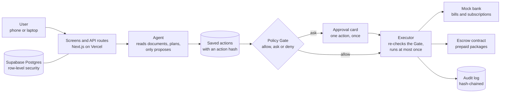

<p align="center">
  
</p>

# Reins

**An AI agent that pays your bills and cancels your subscriptions, but only inside rules you signed. It cannot go past your limits, and it can prove it.**

FinTechathon 2026, International Track, Topic A (Personal Finance Assistant). Demo persona: Lin, a renter in Shenzhen, in CNY.

**Live demo:** https://reins-fintechathon.vercel.app — sign in with any email to get a magic link; see [how to demo it](#how-to-demo-it) below for the full walkthrough.

<p align="center">
  
  
</p>

## The problem, in one minute

AI agents can already pay bills and cancel subscriptions. The missing piece is **trust**: nobody wants to hand their money to an agent they cannot limit, inspect or stop.

Reins fixes that in three steps:

1. **You write your rules once**, in plain words (for example: "pay bills under ¥300 on my own, ask me before cancelling anything, never send money to someone new"). Reins turns them into a fixed, versioned set of rules called the *mandate*.
2. **The agent only proposes.** It reads bills and finds subscriptions, then suggests actions. It never moves money itself.
3. **A plain program, not the AI, decides.** Every action goes through a deterministic *rule check* (the Policy Gate). It says yes, asks you, or says no, and it names the exact rule it used. Anything it is unsure about is refused.

Reins also handles **prepaid packages** (gym, salon, tutoring). The money sits in escrow and is released one session at a time. If the business closes, you get the unused part back, and only you can receive it.

## Early feedback from people in mainland China

Our prepaid-package module is built around a Shenzhen persona, but nobody on the team lives in China. So we asked a few real people from mainland China, all students who go to the gym, about prepaying for gym and tutoring fees. This was informal: a short chat message with a handful of questions, answered in Mandarin and translated by us. It is not a survey, and the sample is too small to generalize.

What they told us, paraphrased:

- Paying for gym or tutoring in advance is normal, and getting a refund when something goes wrong is complicated.
- One person said some gyms in financial trouble close suddenly and the owner disappears, so members cannot recover prepaid money. We treat this as a personal report, not a statistic.
- One person said they would use an escrow like this if it had a clear legal basis, regulatory compliance and adequate security.
- Opinions on price differed by city. A 4,800 yuan package was very expensive to one person and reasonable to another if it includes personal-training sessions.
- One person worried that a third party holding the money could misuse it. This is why our escrow contract has no admin or upgrade functions and only moves money in two ways: a per-session release signed by both sides, or a refund to the plan owner (an early exit that the owner signs can also pay the gym a small, capped fee). A real deployment would still need a licensed operator and an audit. The contract here is a testnet prototype with a valueless token.

## Try it in two minutes (no keys, no database)

You need Node 22 and pnpm 11.

```bash
pnpm install
cp .env.example .env.local
REINS_FIXTURES=1 pnpm dev
```

Open http://localhost:3000. The app shows Lin's data from `fixtures/api/`. Where a feature's server part is not connected yet, the screen says **Sample data** next to its title.

**A short tour:**

| Step | Where | What to look for |
|---|---|---|
| 1 | **Home** | What is due in 14 days and what *needs your OK*. Open a bill: it shows the amount, who gets paid and why it asks, before any button. |
| 2 | **Home**, approve a bill | Approving needs the full stack below (a session and a database). In this quick mode the button fails safely and says "That did not go through. Nothing was paid." With the full stack you approve exactly that one action, once, and a second tap says it was already answered. |
| 3 | **Activity** | Open the blocked payment (a bill PDF that tried to change the account number). It shows the **Rule check**: which rule stopped it. There is no Approve button. |
| 4 | **Subscriptions** | Active plans, free trials and suggestions to cancel, with the yearly saving. Cancelling asks for your OK first. |
| 5 | **Prepaid** | A gym package: sessions left, money held safely, warning signs about the business, and the advice card (what you save, and what you could lose with and without escrow). |
| 6 | **Your rules** | The signed rules as plain sentences, each built from the rule fields, never from AI text. |
| 7 | **Evidence** | The full record with the tamper check, and CSV and JSON export. |
| | **Pause everything** | Always one tap away (top of Home on a phone, bottom of the sidebar on a laptop). The screen says "paused" only after the server confirms. |

More screens, in light and dark, on a laptop and on a phone: [`docs/screenshots/`](docs/screenshots/).

## Why you can trust it

These are the guarantees the code enforces. The full list is in [`AGENTS.md`](AGENTS.md) and the security assessment.

- **The AI cannot move money.** No payment happens unless the rule check allows that exact action at the moment it runs.
- **Documents cannot give orders.** Text from bills, emails and web pages can inform a suggestion but can never decide who gets paid. It is read by a separate, tool-less reader and checked by code.
- **One approval, one action.** An approval is tied to the exact action by a hash. It works once, before it expires.
- **Limits hold under load.** Daily caps are enforced inside a database transaction, so 20 payments at the same time cannot exceed them.
- **Every action runs at most once.**
- **The AI never edits your rules, adds payees, or writes the numbers you see.**
- **Escrowed money has two exits only:** the merchant (one session at a time, with two signatures) or back to you.
- **Everything is on the record.** The log is append-only and hash-chained, so a change or deletion shows up in the tamper check.

## Architecture

One Next.js app and one Postgres database. The AI proposes. A plain program decides. One piece of trusted code acts.



**How to read it**

| Step | What happens | Who is trusted |
|---|---|---|
| Agent | Reads a bill or notice in a sandbox with no tools, then proposes an action as ids and amounts | Not trusted. Document text can inform a suggestion but never decides who gets paid |
| Policy Gate | A pure function checks the action against your signed rules and names the rule it used | Trusted code, no AI |
| Approval | You approve exactly one action; the approval is tied to its hash and expires | You |
| Executor | The only code that can move money. It checks the Gate again at that moment, reserves your daily limit, then calls the bank or the contract | Trusted code |
| Audit log | Every decision is written once and linked to the one before it | Anyone can verify |

**Prepaid packages.** You buy a package with a key made in your browser, which the server never sees. Each session needs your signature and the gym's. If the business closes, a signed official notice lets the agent send the unused money back, and the contract only allows it to go to you.

Read more: [`docs/submission/system-architecture.md`](docs/submission/system-architecture.md) (one page) and [`docs/architecture.md`](docs/architecture.md) (full detail).

## What is real and what is simulated

We want you to know exactly what you are looking at.

| Part | State |
|---|---|
| Web app (7 screens, phone and laptop, sign in by email link) | Built |
| Rule check (Policy Gate), mandate rules, narrowing, approvals, executor, audit log | Built, with unit, property and database tests |
| AI agent (reader, planner, explainer) | Built; the demo can replay recorded model answers (`REINS_MODELS=recorded`), so it runs without an API key |
| Bank | **Simulated** (`/mockbank`), a separate service with its own database role |
| Merchant and official-notice registry | **Simulated** (`src/sim/`), each signs with its own key |
| Prepaid escrow | **Mocked by default on the live demo** (`REINS_ESCROW=mock`, so repeated demo runs don't spend testnet gas). The Solidity contract (`contracts/`) and the chain adapter (`REINS_ESCROW=chain`) are built, tested with Foundry and a local chain, and **deployed to Base Sepolia** — see [Escrow contract](#escrow-contract) below for the live addresses and transaction hashes |
| Buying, check-in and leaving early from the browser | Built. The browser makes the key and signs; the server never sees it. Works on the mock escrow; the simulated gym tablet is at `/sim/tablet` |
| Passkey signing of the mandate | Not built yet; today the stored mandate is checked by its hash |
| Attack results with and without the rule check | Cases are in `evals/`; the numbers are still being produced |

## Run the whole stack

```bash
pnpm exec supabase start           # needs Docker
pnpm exec supabase db reset        # applies migrations, seeds demo user Lin
pnpm db:checkpointer               # agent checkpoint tables
pnpm dev
```

Put the values that `pnpm exec supabase start` prints (database URLs, `NEXT_PUBLIC_SUPABASE_URL`, `NEXT_PUBLIC_SUPABASE_ANON_KEY`) into `.env.local` (see `.env.example`). Then sign in as the seeded user Lin: enter `lin@demo.reins.local` on the sign in page and open the link from the local mail inbox at http://127.0.0.1:54324. With a session, approving, declining and cancelling work against the real routes.

We have tested the routes and the executor against a local database, and the browser sign in against a real, hosted Supabase project is what the live demo at https://reins-fintechathon.vercel.app runs on. If a local run gives trouble, the quick mode above still shows every screen. For API calls without the browser, `REINS_DEMO_AUTH=1` accepts an `x-demo-user: <user id>` header (never in production).

## Deploy (Vercel and a hosted Supabase project)

Local runs need only Docker. A hosted deployment needs two accounts: **Vercel** for the app and **Supabase** (supabase.com) for the database. The plan is in [`docs/architecture.md`](docs/architecture.md) §19. This is a record of what was actually done for the live deployment at https://reins-fintechathon.vercel.app, not just a checklist.

1. **Supabase project.** Create one (the demo project). Note the project ref, the database password, the project URL and the anon key.
2. **Apply the migrations.** From the repo: `pnpm exec supabase link --project-ref <ref>`, then `pnpm exec supabase db push`. Never edit a migration that was already applied; add a new file.
3. **Demo data.** `supabase/seed.sql` loads the demo user Lin. On a hosted project, run it without its two `alter role ... password` lines (they are local passwords), then give `reins_server` and `reins_mockbank` login and strong passwords out of band and run `pnpm db:checkpointer`. The demo project was set up this way.
4. **Sign in links.** In the Supabase dashboard (Authentication, URL configuration) add the deployed site URL and `<site>/auth/callback` to the redirect URLs. Without this, the email link does not work on the deployed site.
5. **Vercel project.** Import the repo, set the Node version to **22.x** (the project default is newer), and add the variables below.
6. **Checks after deploy.** Open the site, sign in, open Home, then try Pause everything. Run `pnpm test` and `pnpm exec playwright test` before tagging `demo-*`.

**Variables for Vercel** (names only; values stay out of git, see `.env.example` for all of them):

| Group | Variables |
|---|---|
| Database | `DATABASE_URL` (pooled, transaction mode), `DATABASE_URL_DIRECT` (migrations and `pnpm db:checkpointer`) |
| Sign in | `NEXT_PUBLIC_SUPABASE_URL`, `NEXT_PUBLIC_SUPABASE_ANON_KEY` |
| Agent | `ANTHROPIC_API_KEY`, `REINS_MODELS` (`recorded` replays saved answers and needs no live calls) |
| Mock bank and simulators | `MOCKBANK_API_KEY`, `MOCKBANK_DATABASE_URL`, `MOCKBANK_URL` and `SIM_BASE_URL` (both must be the deployed URL, not `localhost`), `SIM_API_KEY` |
| Cron | `CRON_SECRET` |
| Escrow | `REINS_ESCROW` (`mock` or `chain`); for `chain`: `CHAIN_ID`, `BASE_SEPOLIA_RPC_URL`, `ESCROW_ADDRESS`, `TOKEN_ADDRESS`, `ORACLE_ADDRESS`, `AGENT_ADDRESS`, `CHAIN_START_BLOCK`, `CHAIN_LOG_CHUNK` (`10` on Alchemy Free tier), and the chain keys listed in `.env.example` |
| Document uploads | `REINS_DOCUMENTS_BUCKET` (defaults to `documents`) and `REINS_STORAGE_READ_TOKEN`, a JWT for a dedicated read-only role so the Reader job can fetch uploaded PDFs with no user session — see [`docs/submission/storage-read-token-setup.md`](docs/submission/storage-read-token-setup.md) |

**Do not set these on a deployed site:** `REINS_FIXTURES` (serves fixture data without a session; ignored when `VERCEL_ENV=production`), `REINS_DEMO_AUTH`, `MOCKBANK_ENABLE_TEST_ROUTES`, `REINS_DEMO_TABLET` and `REINS_EVAL_DISABLE_GATE` (the app refuses to build an executor with it in production).

## How to demo it

Open https://reins-fintechathon.vercel.app, sign in with any email address (it gets a magic link; no password), and open the link.

The live deployment runs `REINS_MODELS=live`, so Reins answers in its own words — you are not limited to a fixed script. A ready-to-follow, under-5-minute walkthrough (sign in → a document attack gets blocked → a normal payment auto-pays while an anomalous one asks for your OK → a prepaid exit is refused without proof and allowed with it → the kill switch → the audit trail) is in [`docs/submission/demo-video-script.md`](docs/submission/demo-video-script.md), including the exact prompts to type at each step.

## Escrow contract

The contract (`PrepaidEscrow`) and the test token (`TestCNY`) are in [`contracts/`](contracts/). Build, test and the local rehearsal are in [`contracts/README.md`](contracts/README.md), which also has the Base Sepolia deploy steps.

**Deployed addresses (Base Sepolia, chain 84532)**, from `contracts/deployments/84532.json` (deploy block 48356082):

| Contract | Address |
|---|---|
| PrepaidEscrow | [`0xcf9e41a7891339D5229B2e3744d80Fe63B7337d0`](https://sepolia.basescan.org/address/0xcf9e41a7891339D5229B2e3744d80Fe63B7337d0) |
| TestCNY (tCNY, no value) | [`0x7218ACcba071865e31eA60CA740Dd8d0568587F1`](https://sepolia.basescan.org/address/0x7218ACcba071865e31eA60CA740Dd8d0568587F1) |
| Oracle (registry signer) | [`0x280F4572D9f816d6019834B9c94cA826318aBB6A`](https://sepolia.basescan.org/address/0x280F4572D9f816d6019834B9c94cA826318aBB6A) |

The full purchase → redeem → attested-exit lifecycle has been run on this contract, both as an isolated spike and end to end through the app (Lin's FitBox plan: bought, checked in 12 times, then exited after an oracle-signed closure notice). Every transaction hash with its Basescan link is in [`docs/evidence/spike.md`](docs/evidence/spike.md).

The contract is a testnet demo with a valueless token and is **not audited**. See [`docs/submission/security-self-assessment.md`](docs/submission/security-self-assessment.md).

## Tests

```bash
pnpm lint && pnpm typecheck && pnpm test
pnpm exec playwright test          # browser flows on a production build
```

`pnpm test` runs unit and property tests. The database suites are skipped when `DATABASE_URL` is not set. Playwright runs the phone and laptop layouts against fixtures; stop `pnpm dev` first because both use `.next`.

## Where to read more

| Document | What it covers |
|---|---|
| [`docs/PRD_Reins_v2.0.md`](docs/PRD_Reins_v2.0.md) | What we are building and why |
| [`docs/architecture.md`](docs/architecture.md) | How it is built: rule check, executor, data, escrow |
| [`docs/submission/system-architecture.md`](docs/submission/system-architecture.md) | The system in one read: parts, trust zones, how one payment flows |
| [`docs/submission/agent-design.md`](docs/submission/agent-design.md) | The agent graph and where security sits in it |
| [`docs/submission/core-algorithms.md`](docs/submission/core-algorithms.md) | Detection, advice and summary algorithms |
| [`docs/submission/injection-defenses.md`](docs/submission/injection-defenses.md) | How untrusted text is kept away from money |
| [`docs/submission/security-self-assessment.md`](docs/submission/security-self-assessment.md) | Permission tiers, guarantees and known risks |
| [`docs/submission/execution-evidence.md`](docs/submission/execution-evidence.md) | Proof the demos actually ran: real Base Sepolia transactions and sandbox logs |
| [`docs/submission/ux-design.md`](docs/submission/ux-design.md) | The screens, wording and accessibility |
| [`docs/submission/demo-video-script.md`](docs/submission/demo-video-script.md) | The live-demo walkthrough: steps, timing and exact prompts |
| [`docs/evidence/spike.md`](docs/evidence/spike.md) | Every Base Sepolia transaction hash with its Basescan link |
| [`docs/ui-direction.md`](docs/ui-direction.md) | Look, words and layout rules |

## Repository map

| Folder | Contents |
|---|---|
| `app/` | Next.js pages and API routes |
| `src/core/` | Pure logic: Policy Gate, mandate, detectors (no I/O) |
| `src/agent/` | The LangGraph agent |
| `src/server/` | Executor, approvals, audit log, database reads |
| `src/ui/` | Screens and components |
| `src/mockbank/`, `src/sim/` | The simulated bank, merchant and registry |
| `supabase/` | Migrations and seed data |
| `evals/` | Attack cases and recorded model answers |
| `e2e/`, `tests/` | Browser and unit tests |

Built with Next.js 16, React 19, Tailwind 4, LangGraph.js, Supabase (Postgres), viem and Vitest.
