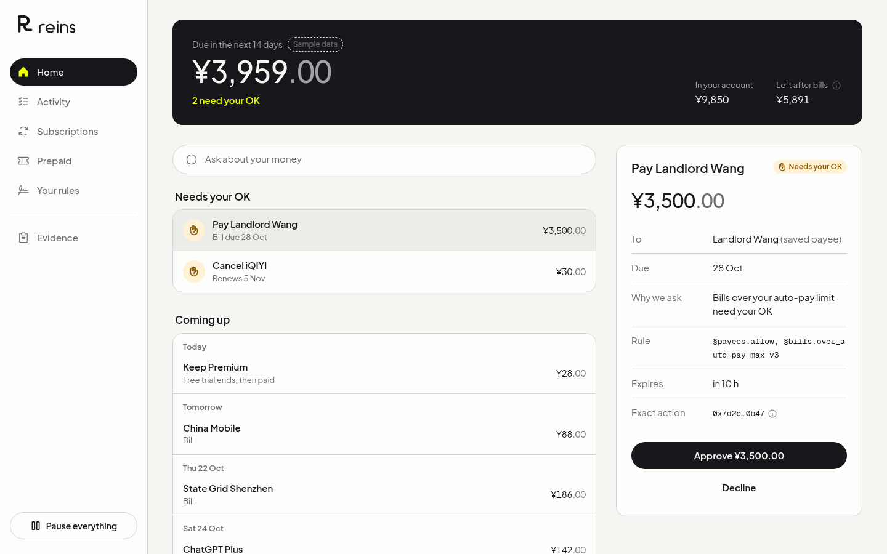
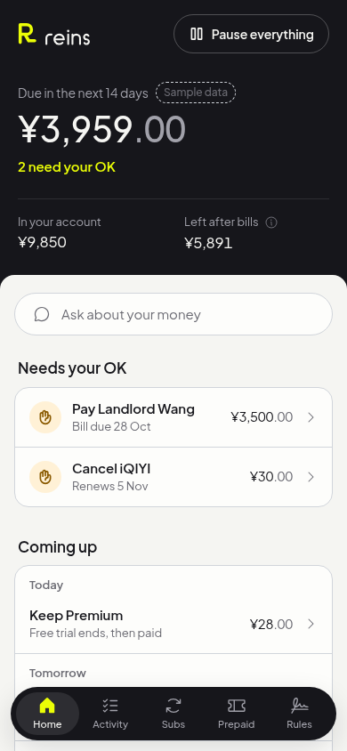

<p align="center">
  
</p>

# Reins

**An AI agent that pays your bills and cancels your subscriptions, but only inside rules you signed. It cannot go past your limits, and it can prove it.**

FinTechathon 2026, International Track, Topic A (Personal Finance Assistant). Demo persona: Lin, a renter in Shenzhen, in CNY.

<p align="center">
  
  
</p>

## The problem, in one minute

AI agents can already pay bills and cancel subscriptions. The missing piece is **trust**: nobody wants to hand their money to an agent they cannot limit, inspect or stop.

Reins fixes that in three steps:

1. **You write your rules once**, in plain words (for example: "pay bills under ¥300 on my own, ask me before cancelling anything, never send money to someone new"). Reins turns them into a fixed, versioned set of rules called the *mandate*.
2. **The agent only proposes.** It reads bills and finds subscriptions, then suggests actions. It never moves money itself.
3. **A plain program, not the AI, decides.** Every action goes through a deterministic *rule check* (the Policy Gate). It says yes, asks you, or says no, and it names the exact rule it used. Anything it is unsure about is refused.

Reins also handles **prepaid packages** (gym, salon, tutoring). The money sits in escrow and is released one session at a time. If the business closes, you get the unused part back, and only you can receive it.

## Try it in two minutes (no keys, no database)

You need Node 22 and pnpm 11.

```bash
pnpm install
cp .env.example .env.local
REINS_FIXTURES=1 pnpm dev
```

Open http://localhost:3000. The app shows Lin's data from `fixtures/api/`. Where a feature's server part is not connected yet, the screen says **Sample data** next to its title.

**A short tour:**

| Step | Where | What to look for |
|---|---|---|
| 1 | **Home** | What is due in 14 days and what *needs your OK*. Open a bill: it shows the amount, who gets paid and why it asks, before any button. |
| 2 | **Home**, approve a bill | Approving needs the full stack below (a session and a database). In this quick mode the button fails safely and says "That did not go through. Nothing was paid." With the full stack you approve exactly that one action, once, and a second tap says it was already answered. |
| 3 | **Activity** | Open the blocked payment (a bill PDF that tried to change the account number). It shows the **Rule check**: which rule stopped it. There is no Approve button. |
| 4 | **Subscriptions** | Active plans, free trials and suggestions to cancel, with the yearly saving. Cancelling asks for your OK first. |
| 5 | **Prepaid** | A gym package: sessions left, money held safely, warning signs about the business, and the advice card (what you save, and what you could lose with and without escrow). |
| 6 | **Your rules** | The signed rules as plain sentences, each built from the rule fields, never from AI text. |
| 7 | **Evidence** | The full record with the tamper check, and CSV and JSON export. |
| | **Pause everything** | Always one tap away (top of Home on a phone, bottom of the sidebar on a laptop). The screen says "paused" only after the server confirms. |

More screens, in light and dark, on a laptop and on a phone: [`docs/screenshots/`](docs/screenshots/).

## Why you can trust it

These are the guarantees the code enforces. The full list is in [`AGENTS.md`](AGENTS.md) and the security assessment.

- **The AI cannot move money.** No payment happens unless the rule check allows that exact action at the moment it runs.
- **Documents cannot give orders.** Text from bills, emails and web pages can inform a suggestion but can never decide who gets paid. It is read by a separate, tool-less reader and checked by code.
- **One approval, one action.** An approval is tied to the exact action by a hash. It works once, before it expires.
- **Limits hold under load.** Daily caps are enforced inside a database transaction, so 20 payments at the same time cannot exceed them.
- **Every action runs at most once.**
- **The AI never edits your rules, adds payees, or writes the numbers you see.**
- **Escrowed money has two exits only:** the merchant (one session at a time, with two signatures) or back to you.
- **Everything is on the record.** The log is append-only and hash-chained, so a change or deletion shows up in the tamper check.

## What is real and what is simulated

We want you to know exactly what you are looking at.

| Part | State |
|---|---|
| Web app (7 screens, phone and laptop, sign in by email link) | Built |
| Rule check (Policy Gate), mandate rules, narrowing, approvals, executor, audit log | Built, with unit, property and database tests |
| AI agent (reader, planner, explainer) | Built; the demo can replay recorded model answers (`REINS_MODELS=recorded`), so it runs without an API key |
| Bank | **Simulated** (`/mockbank`), a separate service with its own database role |
| Merchant and official-notice registry | **Simulated** (`src/sim/`), each signs with its own key |
| Prepaid escrow | **Mocked** (`REINS_ESCROW=mock`). The Solidity contract on Base Sepolia (test token, no value) is **not built yet** |
| Buying, check-in and leaving early from the browser | Not built yet; the buttons are shown disabled with the reason |
| Passkey signing of the mandate | Not built yet; today the stored mandate is checked by its hash |
| Attack results with and without the rule check | Cases are in `evals/`; the numbers are still being produced |

## Run the whole stack

```bash
pnpm exec supabase start           # needs Docker
pnpm exec supabase db reset        # applies migrations, seeds demo user Lin
pnpm db:checkpointer               # agent checkpoint tables
pnpm dev
```

Put the values that `pnpm exec supabase start` prints (database URLs, `NEXT_PUBLIC_SUPABASE_URL`, `NEXT_PUBLIC_SUPABASE_ANON_KEY`) into `.env.local` (see `.env.example`). Then sign in as the seeded user Lin: enter `lin@demo.reins.local` on the sign in page and open the link from the local mail inbox at http://127.0.0.1:54324. With a session, approving, declining and cancelling work against the real routes.

We have tested the routes and the executor against a local database, but the browser sign in against a real Supabase project has not been tried end to end yet. If it gives trouble, the quick mode above still shows every screen. For API calls without the browser, `REINS_DEMO_AUTH=1` accepts an `x-demo-user: <user id>` header (never in production).

## Tests

```bash
pnpm lint && pnpm typecheck && pnpm test
pnpm exec playwright test          # browser flows on a production build
```

`pnpm test` runs unit and property tests. The database suites are skipped when `DATABASE_URL` is not set. Playwright runs the phone and laptop layouts against fixtures; stop `pnpm dev` first because both use `.next`.

## Where to read more

| Document | What it covers |
|---|---|
| [`docs/PRD_Reins_v2.0.md`](docs/PRD_Reins_v2.0.md) | What we are building and why |
| [`docs/architecture.md`](docs/architecture.md) | How it is built: rule check, executor, data, escrow |
| [`docs/submission/agent-design.md`](docs/submission/agent-design.md) | The agent graph and where security sits in it |
| [`docs/submission/core-algorithms.md`](docs/submission/core-algorithms.md) | Detection, advice and summary algorithms |
| [`docs/submission/injection-defenses.md`](docs/submission/injection-defenses.md) | How untrusted text is kept away from money |
| [`docs/submission/security-self-assessment.md`](docs/submission/security-self-assessment.md) | Permission tiers, guarantees and known risks |
| [`docs/submission/ux-design.md`](docs/submission/ux-design.md) | The screens, wording and accessibility |
| [`docs/ui-direction.md`](docs/ui-direction.md) | Look, words and layout rules |

## Repository map

| Folder | Contents |
|---|---|
| `app/` | Next.js pages and API routes |
| `src/core/` | Pure logic: Policy Gate, mandate, detectors (no I/O) |
| `src/agent/` | The LangGraph agent |
| `src/server/` | Executor, approvals, audit log, database reads |
| `src/ui/` | Screens and components |
| `src/mockbank/`, `src/sim/` | The simulated bank, merchant and registry |
| `supabase/` | Migrations and seed data |
| `evals/` | Attack cases and recorded model answers |
| `e2e/`, `tests/` | Browser and unit tests |

Built with Next.js 16, React 19, Tailwind 4, LangGraph.js, Supabase (Postgres), viem and Vitest.
